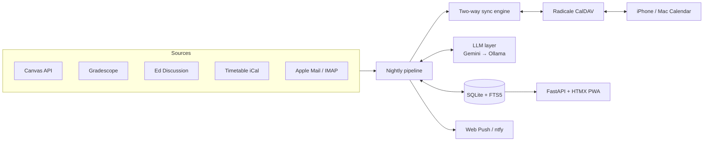

# UniPlan

A self-hosted planner for university life. Every night it pulls data from Canvas, Gradescope, Ed Discussion, my ANU timetable and my email, works out what actually matters, and keeps an editable calendar on my iPhone and Mac in sync with it.

The information a student needs each week is spread across five systems, and a class moved in a Canvas announcement never reaches the timetable. UniPlan pulls all of that into one place.

**Python 3.13 · FastAPI · SQLite · CalDAV · Gemini + Ollama · HTMX · Tailwind · Web Push**

## What it does

- **Two-way calendar sync.** Publishes Classes, Due Dates, Exams, Study Blocks and Personal calendars over CalDAV. Edits made on my phone survive the next sync.
- **Reads announcements for me.** An LLM extracts deadlines, exam details and class changes from announcements, forum posts and email, each with a confidence score and the sentence it came from.
- **Applies class changes automatically.** A cancelled or moved class is overlaid on the timetable when the match is confident and unambiguous. Anything else waits in a review queue.
- **Tracks marks.** Weighted averages, the score needed for each grade band, and what-if scenarios, merging duplicate items across Canvas and Gradescope.
- **Plans study time.** Places study blocks in free time before each due date and shows a workload heatmap by week.
- **Answers questions with sources.** Full-text search over everything collected, with LLM answers that cite the original items.
- **Sends short push notifications** when something new appears, as an installable PWA on iPhone.

## Architecture



The whole thing runs as a single `launchd` service on one machine: web app, CalDAV server and scheduler. Remote access goes through Tailscale, so nothing is exposed to the public internet.

## Engineering highlights

**Three-way conflict detection.** For each event the sync engine stores a hash of what the sources wanted and a semantic hash of what it wrote, then compares both against the server's current copy. That separates four cases: nothing changed, the source changed, I edited it, or both changed. Only the last one needs a human. Deleted events stay deleted unless the source later changes them. See [`calendar_sync.py`](uniplan/calendar_sync.py).

**Isolated failure across unreliable sources.** Each source is fetched independently, so an expired Gradescope session doesn't stop the Canvas sync. Per-source status is shown on a health page, and a push goes out when a credential needs renewing. Content hashes make "new vs. updated vs. unchanged" deterministic, so only changed items are sent to the LLM.

**LLM output treated as untrusted.** Extraction uses structured schemas and carries a confidence score plus the quoted source sentence. Low-confidence or ambiguous results go to a person rather than onto the calendar. The threshold is adjustable.

**Resilient model access at zero cost.** Calls go through an ordered chain of Gemini free-tier models with rate limiting and retries on 429 and 5xx responses, then fall back to a local Ollama model. Model names are explicit config, because some models offered by the API have no free quota.

**Evidence before building.** Each integration was proven by a throwaway script first ([feasibility notes](spikes/PHASE0.md)). That caught real constraints early: ANU blocks Microsoft Graph app registrations and forces SSO on Gradescope, and small local models scored 66–69% on my extraction benchmark against 93% for Gemini Flash-Lite. The design changed in response: a saved SSO browser session, mail read through Apple Mail, and Gemini as the primary model.

**Privacy by default.** Data stays on the Mac in SQLite. Secrets live in a gitignored `.env` or the macOS Keychain, push notifications carry only short summaries, and web push is end-to-end encrypted.

## Project layout

```
uniplan/
├── sources/          Canvas, Gradescope, Ed, timetable, email and course-page fetchers
├── pipeline.py       Nightly orchestration
├── extract.py        LLM extraction and class-change matching
├── llm.py            Model chain, rate limiting, retries
├── calendar_sync.py  Two-way CalDAV engine
├── planner.py        Calendar events, study blocks, workload
├── marks.py          Marks, grade bands, what-if
├── chat.py           Search and cited answers
├── webpush.py        VAPID web push
└── web/              FastAPI app, Jinja templates, HTMX, service worker
tests/                pytest suite
spikes/               Feasibility scripts and notes
```

## Testing

```bash
uv run pytest
```

52 tests cover conflict classification, marks maths, class-change matching and parsing, the planner, web routes and push. One integration test does a real round trip against a live Radicale server, including a simulated phone edit. Tests use fixtures and never call the live services.

## Running it

UniPlan is built for my own accounts and for ANU's systems, so it assumes macOS and an ANU enrolment, though the Canvas and CalDAV layers are general.

```bash
git clone https://github.com/rufus-gh/uniplan.git && cd uniplan
cp .env.example .env
uv run uniplan serve
```

Full setup, including iPhone calendars and notifications, is in [docs/SETUP.md](docs/SETUP.md).

## Author

Rufus Gordon-Heywood · [GitHub](https://github.com/rufus-gh)
